<div align="center">



<br><br>

<a href="https://elghoth.live"></a>
&nbsp;
<a href="mailto:elghothvadel@gmail.com"></a>
&nbsp;
<a href="https://github.com/cheikhtourad19?tab=repositories"></a>

<br><br>

**APIs & microservices** &nbsp; / &nbsp; **Containerized delivery** &nbsp; / &nbsp; **AI-powered applications**


</div>

## 👨‍💻 A little about me

I'm **Mohamed Elgheith**, a final-year Software Engineering student at **ESPRIM, Monastir**. My main interests are backend development, distributed systems, and the tools that take an application from source code to deployment.

I enjoy working across the stack: designing APIs, connecting services, building interfaces, and automating delivery. My projects also explore how semantic search, retrieval-augmented generation, and NLP can make software more useful.

```yaml
focus:       [backend engineering, distributed systems, DevOps]
building:    [APIs, microservices, AI-powered applications]
exploring:   [Kubernetes, cloud architecture, automation]
looking_for: a final-year internship starting in February 2027
```


## 🚀 Projects I'm proud to share

<table>
<tr>
<td width="50%" valign="top">
<h3>🌍 <a href="https://github.com/cheikhtourad19/tuniscope-arabic-nlp">TuniScope</a></h3>
<p>An ongoing Arabic NLP project comparing approaches to Arabic variety identification and Tunisian sentiment analysis.</p>
<p><code>Python</code> <code>TF-IDF</code> <code>Transformers</code> <code>LoRA</code></p>
<p><b>Focus:</b> reproducible evaluation and understanding model behaviour.</p>
<a href="https://github.com/cheikhtourad19/tuniscope-arabic-nlp">Explore the repository →</a>
</td>
<td width="50%" valign="top">
<h3>📚 <a href="https://github.com/cheikhtourad19/KnowledgeHub">KnowledgeHub</a></h3>
<p>An academic document platform with a microservices architecture and AI-powered semantic search, developed during my ESPRIM internship.</p>
<p><code>FastAPI</code> <code>ChromaDB</code> <code>RAG</code> <code>Docker</code> <code>CI/CD</code></p>
<p><b>Focus:</b> connecting document retrieval, application services, and delivery workflows.</p>
<a href="https://github.com/cheikhtourad19/KnowledgeHub">Explore the repository →</a>
</td>
</tr>
<tr>
<td width="50%" valign="top">
<h3>🧩 ExamTracker</h3>
<p>A distributed exam-monitoring platform exploring the integration of backend and AI services.</p>
<p><code>Backend engineering</code> <code>Distributed systems</code> <code>AI integration</code></p>
<p><b>Focus:</b> coordinating application services in a distributed architecture.</p>
</td>
<td width="50%" valign="top">
<h3>🧠 <a href="https://github.com/cheikhtourad19/brain_tumor_detection">Brain Tumor Detection</a></h3>
<p>An image-classification project exploring brain tumor detection with convolutional neural networks and transfer learning.</p>
<p><code>Python</code> <code>TensorFlow</code> <code>Keras</code> <code>scikit-learn</code></p>
<p><b>Focus:</b> model training and evaluation with confusion matrices, per-class recall, and ROC-AUC.</p>
<a href="https://github.com/cheikhtourad19/brain_tumor_detection">Explore the repository →</a>
</td>
</tr>
</table>

More project details on my **[portfolio](https://elghoth.live)**, and source code in my **[public repositories](https://github.com/cheikhtourad19?tab=repositories)**.


## 🛠️ My technical toolkit

<table>
<tr>
<td width="50%" valign="top">
<h3>Backend</h3>

<p>Go · Java · Spring Boot · Spring Cloud · Python · FastAPI · Node.js · NestJS</p>
</td>
<td width="50%" valign="top">
<h3>Frontend</h3>

<p>Angular · React · Next.js</p>
</td>
</tr>
<tr>
<td width="50%" valign="top">
<h3>DevOps & tooling</h3>

<p>Docker · Jenkins · GitHub Actions · Git · Linux</p>
</td>
<td width="50%" valign="top">
<h3>Data</h3>

<p>PostgreSQL · MySQL · MongoDB · Redis · ChromaDB</p>
</td>
</tr>
<tr>
<td width="50%" valign="top">
<h3>Applied AI</h3>
<p>Semantic search · Retrieval-augmented generation (RAG) · Ollama · NLP · TensorFlow / Keras · scikit-learn</p>
</td>
<td width="50%" valign="top">
<h3>Currently exploring</h3>
<p>Kubernetes · Cloud architecture · Infrastructure automation</p>
</td>
</tr>
</table>


## 💼 Hands-on experience

**Virtual Era — Software Development Intern**

Worked on RFID inventory management and traceability applications using **Spring Boot and Angular**, connecting backend business logic with user-facing workflows.

**ESPRIM — Software Development Intern**

Developed **KnowledgeHub**, an academic document platform with microservices and semantic search. Worked with **FastAPI, ChromaDB, Docker, Jenkins, and GitHub Actions** to connect AI features with application services and delivery workflows.


## 📊 GitHub activity

<div align="center">

<a href="https://github-stats-extended.vercel.app/api/top-langs?username=cheikhtourad19&amp;langs_count=5&amp;theme=gruvbox_light"></a>
&nbsp;
<a href="https://github-stats-extended.vercel.app/api?username=cheikhtourad19&amp;show=reviews%2Cdiscussions_started%2Cdiscussions_answered%2Cprs_merged%2Cprs_merged_percentage%2Cprs_commented%2Cprs_reviewed%2Cissues_commented%2Ccontributions%2Call_time_contribs&amp;show_icons=true&amp;include_all_commits=true&amp;theme=solarized-light"></a>

</div>


## 🤝 Let's build something useful

I'm looking for a **final-year internship (PFE)** where I can contribute to backend systems, full-stack applications, DevOps, or applied AI.

| Availability | Details |
| :--- | :--- |
| **Start** | 1 February 2027 |
| **Duration** | 4–6 months, adaptable to the project |
| **Preferred setup** | Remote from Tunisia; international teams welcome |
| **On-site availability** | Monastir or Sousse, Tunisia |

<div align="center">

<br>

**Have a project that fits? Let's talk.**

<a href="mailto:elghothvadel@gmail.com"></a>

<br><br>

[Portfolio](https://elghoth.live) &nbsp; · &nbsp; [GitHub](https://github.com/cheikhtourad19)


</div>
